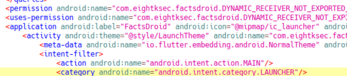
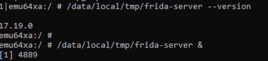
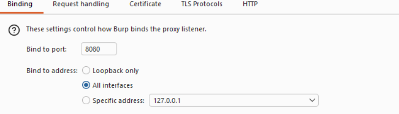
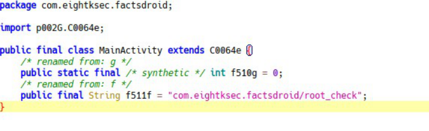
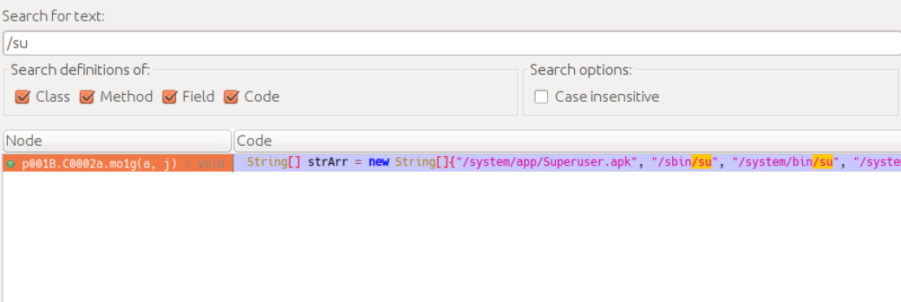
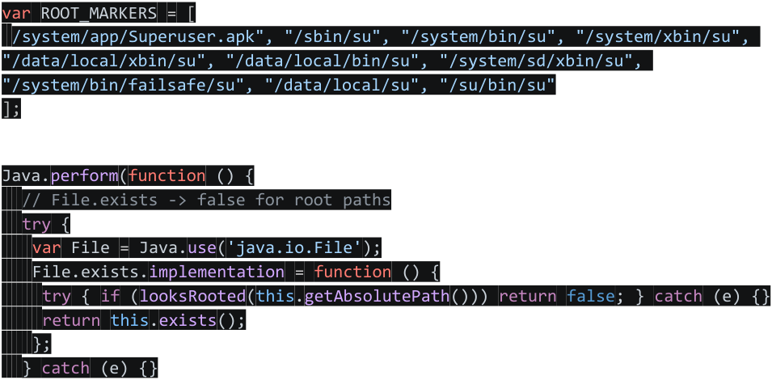
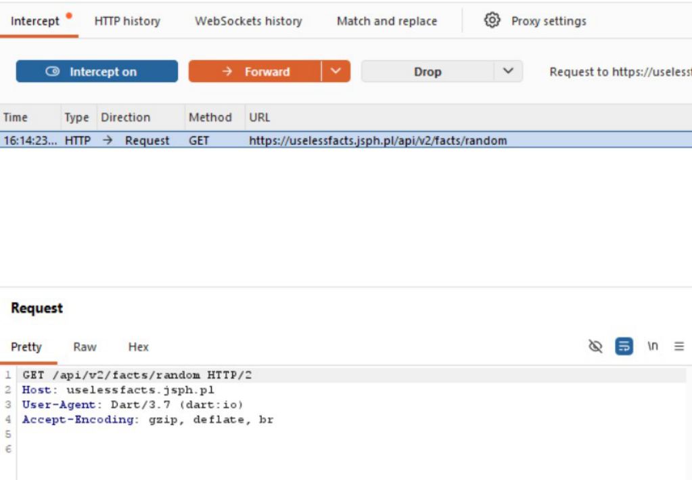
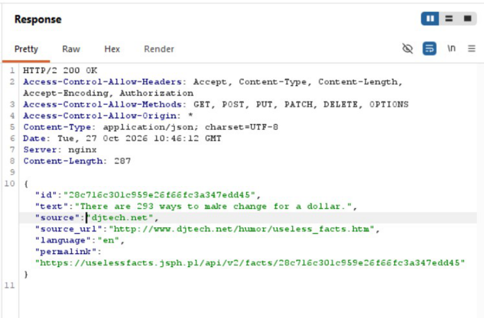
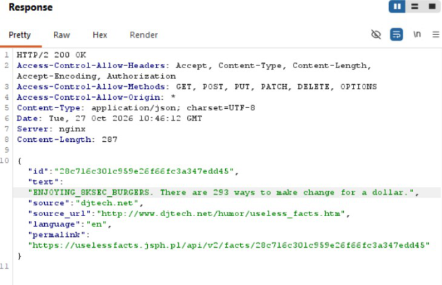

*Challenge designed by [8kSec](https://8ksec.io/).*

---

# **<u>Writeup for Challenge : "FactsDroid : Your Universal Knowledgebase"</u>** 

# **<u>1. Objectives:</u>** 

- Intercept network traffic generated by FactsDroid. 

- Modify api requests and responses between FactsDroid and its backend server. 

- Implement MITM attack that allows manipulated results to be shown to user. 

# **2. Restrictions:** 

- No static modification or patching of the apk is allowed. 

- Approach should apply to modern Android versions ( 14+). 

- Complete interception workflow should be demonstrated including the setup for interception. 

# **<u>3. TL;DR:</u>** 

- FactsDroid is a flutter-based android app. The challenge requires us to bypass SSLpinning and get the device to BurpSuite interception working. 

- A normal Java/kotlin android app respects the system proxy plus implements SSL pinning in dex, so we can use Frida to rewrite those exact method implementations. There are a set of methods -  okhttp, trustmanager etc. which are normally used in a typical app. 

- Flutter ignores system proxy, Android CA store and we don't have those JAVA methods to hook using Frida. Its ssl-pinning implementation  - the dart code for it is compiled into libflutter.so – no straightforward java method hooking possible here. 

- The completely dynamic solution would be: 

   - Reroute all tls traffic of emulator to Burp using iptables 

   - Bypass root-check of the app 

   - bypass ssl-pinning inside libflutter.so 

   - in BurSuite, modify the response text field to display attacker controlled text 

# **<u>4. Recon</u>** 

As I would normally, I openjadx-gui on my ubuntu VM and load the apk on it. A first look at AndroidManifest.xml tells me its flutter code and jadx would not be very useful from this point onwards. 

I note the package name, target sdk version and min sdk versions and permissions. 

- Package name: com.eightksec.factsdroid 

- minSdk: 21 

- targetSdk =: 35 

I know that flutter- based app has dart compiled codes - .so files. So I unzip the apk and locate the lib folder. I know that the challenge is about network requests manipulation, so I run strings on the native library files and try to see if it throws up any endpoints which look interesting. 

Found this in strings – "assets/certs/uselessfacts_jsph_pl.crt". What this means is that the app comes bundled with a certificate for a specific host. Mostly, it tells me that most probably the app talks to uselessfacts.jsph.pl and probably implements ssl pinning. 

Also found in strings – com.eightksec.factsdroid/root_check, indicating that probably better to integrate root bypass script in Frida. 

# **<u>5. Lab Setup</u>** 

I set up an avd emulator having Android 15 ( x86_64, rooted) and set up Frida-server ( version 17.19.0) 

I set up Burp proxy listener on port 8080, listening to all interfaces and invisible proxying on. 

Next step is to reroute all emulator tls traffic to Burpsuite using iptables. Since we are using avd, the alias to host's localhost is 10.0.22. 

So this follows: 

And then I install the apk on emulator using adb 

adb -s emulator-5554 install "C:XXXX\FactsDroid.apk\FactsDroid.apk" 

# **<u>6. Bypass root check</u>** 

I tried to find how it might be implementing root detection using jadx. 

String[] strArr = new String[]{"/system/app/Superuser.apk", "/sbin/su", "/system/bin/su", "/system/xbin/su", "/data/local/xbin/su", "/data/local/bin/su", "/system/sd/xbin/su", "/system/bin/failsafe/su", "/data/local/su", "/su/bin/su"}; 

That is the usual Fle.exists() su-paths check. So I put together a simple bypass script. 

<!-- Start of picture text -->
var ROOT_MARKERS = [ /system/app/Superuser.apk", "/sbin/su", "/system/bin/su", "/system/xbin/su", "/data/local/xbin/su", "/data/local/bin/su", "/system/sd/xbin/su", "/system/bin/failsafe/su", "/data/local/su", "/su/bin/su" ]; Java.perform(function () { // File.exists -> false for root paths try  { var File = Java.use('java.io.File' ); File.exists.implementation = function () { try {  if (looksRooted(this.getAbsolutePath())) return false; } catch (e) {} return this.exists(); }; } catch (e) {} <!-- End of picture text -->

With this I was able to bypass root detection and get app running on emulator. 

# **<u>7. Bypass the SSL pinning</u>** 

SSL pinning is implemented in BoringSSL function in libflutter.so" . The idea is to force it tor return 1. Problem is to find its offset from the .so file so that wecan rewrite its implementation. So I tried fingerprinting technique  - find the function which uses strings "ssl_Client" , "ssl_server". Then find the code pointing at them – lea[rip + d] . 

I found the offset at 0x7d886b relevant for the x86_64 arch. So I added to my frida script - `Interceptor.attach(Module.findBaseAddress('libflutter.so').add(0x7d886b), { onLeave: function (r) { r.replace(0x1); } })` 

# **<u>8. Performing MITM</u>** 

I launch the emulator and spawned the app injecting my frida script . frida -U -f com.eightksec.factsdroid -l "D:\8ksec_ch1\factsdroid_bypass.js" 

In Burp I turn interception ON and see the request.  Requests are going to endpoint <u>https://uselessfacts.jsph.pl/api/v2/facts/random. I do Do-intercept → Response to this reuest and fire</u> the "random-fact" button on app again. 

I figure I can change the "text" field. So I insert random text "ENJOYING_8KSEC_BURGERS" into it. And then on forwarding I can see the change on app. 

# **<u>9. Key Takeaway</u>** 

The real challenge in this was the app being Flutter-based. And MITM required a primary skill of knowing what to look for in an ELF file. "Reflutter" is popularly used for flutter based android apps but the restriction posed for for not allowing the patch the binary made it irrelevant. So we must be ready for dynamic solutions when it comes to handling app reversing. 
